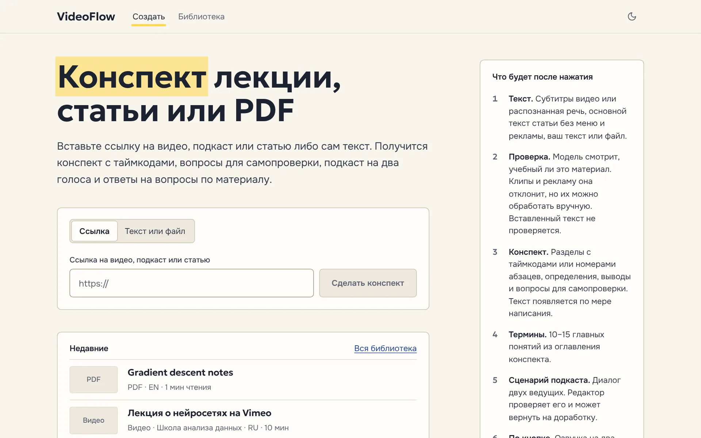
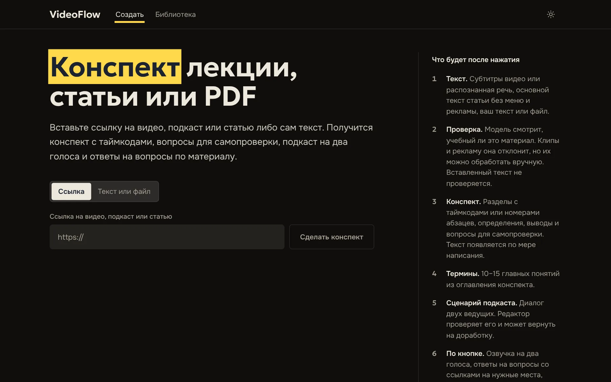
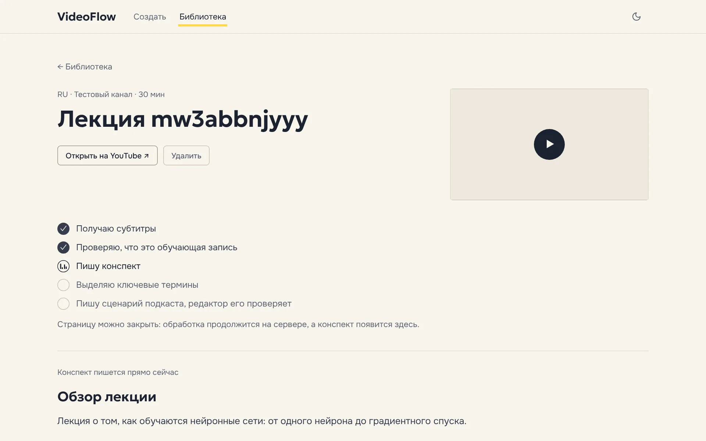
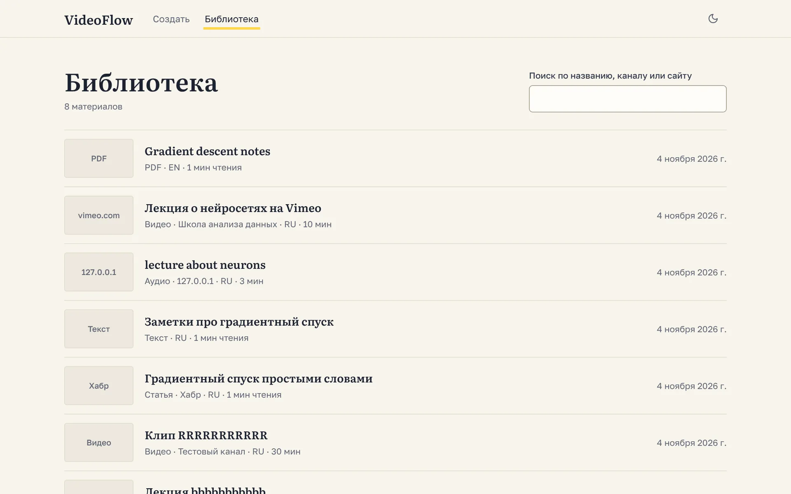
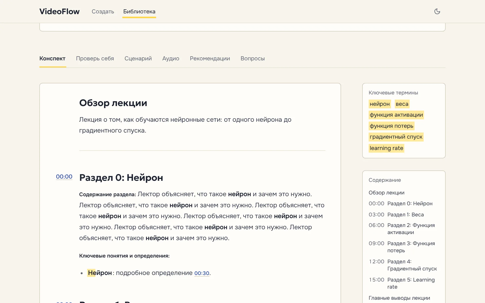
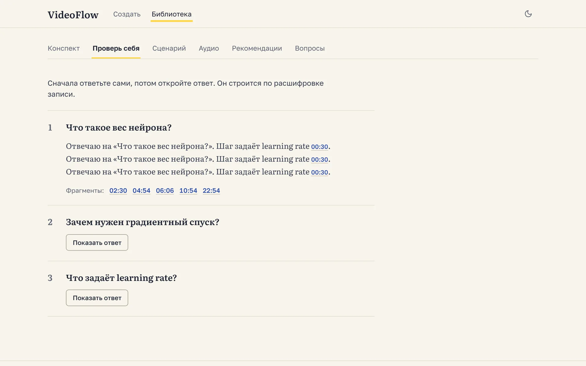
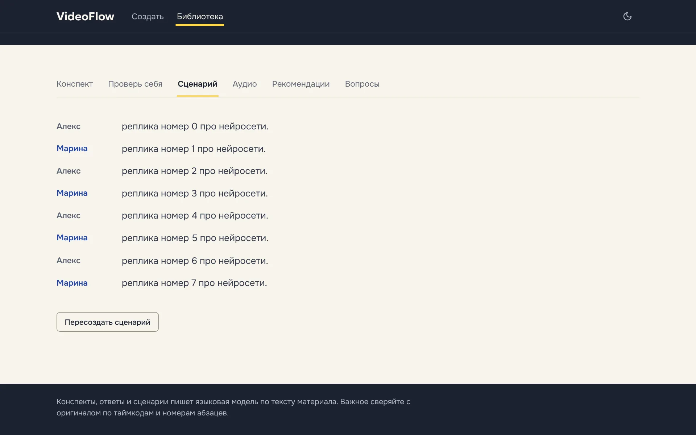
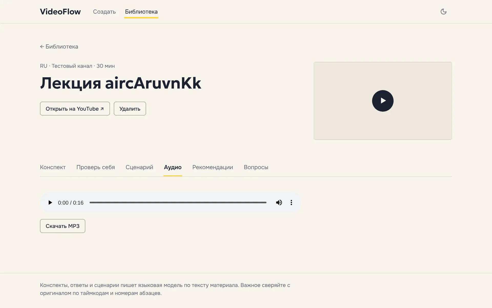

# 🎙️ VideoFlow — AI Podcast Creator

**VideoFlow** — мультиагентная система на базе LangGraph, которая превращает образовательные YouTube-видео в конспекты и подкасты. Система извлекает транскрипт, отсеивает необучающий контент, пишет подробный конспект с таймкодами, сценарий диалога двух ведущих, озвучивает его и отвечает на вопросы по видео через RAG (Retrieval-Augmented Generation).



---

## 📋 Оглавление

- [Возможности](#-возможности)
- [Скриншоты](#-скриншоты)
- [Архитектура](#-архитектура)
- [Технологический стек](#-технологический-стек)
- [Структура проекта](#-структура-проекта)
- [Установка и запуск](#-установка-и-запуск)
  - [Docker](#docker)
  - [Локальный запуск](#локальный-запуск)
  - [Тесты](#тесты)
- [Переменные окружения](#-переменные-окружения)
- [Доступ и лимиты](#-доступ-и-лимиты)
- [API документация](#-api-документация)
- [Мультиагентный пайплайн](#-мультиагентный-пайплайн)
- [RAG система](#-rag-система-вопрос-ответ)
- [Интерфейс](#-интерфейс)

---

## ✨ Возможности

| Функция | Описание |
|---|---|
| 🎬 **Извлечение транскрипта** | Субтитры на русском, английском или казахском, а если их нет — на любом языке видео; без субтитров речь распознаётся через Groq Whisper |
| 🔍 **Классификация контента** | ИИ пропускает только обучающие видео и судит по началу, середине и концу ролика; отклонённое видео можно всё равно обработать |
| 📝 **Конспект** | Разделы с таймкодами, глоссарий и главные выводы; пишется у вас на глазах (потоково) и сохраняется сразу, до сценария |
| 🧠 **Проверь себя** | Вопросы для самопроверки карточками: ответ скрыт, пока его не откроешь, строится по транскрипту и кэшируется |
| 🔑 **Ключевые термины** | 10–15 терминов всей лекции — по оглавлению и выделенным понятиям конспекта |
| 🎙️ **Сценарий подкаста** | Диалог двух ведущих (Алекс и Марина), каждую версию проверяет редактор-критик |
| 🔊 **Аудио** | Две озвучки ElevenLabs, реплики озвучиваются параллельно и склеиваются без перекодирования (128 кбит/с) |
| 💬 **Вопросы по видео** | Гибридный поиск (векторы + BM25 со стеммингом), потоковый ответ со ссылками на моменты видео, уточняющие вопросы |
| ▶️ **Встроенный плеер** | Таймкоды запускают видео прямо на странице; при прокрутке плеер остаётся в углу |
| 🎯 **Рекомендации** | Онлайн-курсы и книги по теме — поиск Tavily по сайтам курсов и книжным магазинам |
| ⚙️ **Фоновая обработка** | Работа идёт на сервере: вкладку можно закрыть или обновить, одинаковые запросы не дублируются, прерванная обработка продолжается после перезапуска |
| 💾 **Мгновенный кэш** | Видео хранятся бессрочно; повторная ссылка на то же видео в любом формате отдаётся из базы без запросов к YouTube и LLM |
| 🔐 **Доступ** | Необязательный пароль приложения, токен API и почасовые лимиты на дорогие операции |
| 🌓 **Веб-интерфейс** | Next.js с серверным рендерингом, библиотека с поиском, экспорт конспекта в Markdown, тёмная и светлая тема |

---

## 📸 Скриншоты

<table>
  <tr>
    <td></td>
    <td></td>
  </tr>
  <tr>
    <td align="center">Главная — светлая тема</td>
    <td align="center">Главная — тёмная тема</td>
  </tr>
  <tr>
    <td></td>
    <td></td>
  </tr>
  <tr>
    <td align="center">Шаги обработки нового видео</td>
    <td align="center">Библиотека</td>
  </tr>
  <tr>
    <td></td>
    <td></td>
  </tr>
  <tr>
    <td align="center">Конспект с оглавлением</td>
    <td align="center">Проверь себя: ответ по транскрипту</td>
  </tr>
  <tr>
    <td></td>
    <td></td>
  </tr>
  <tr>
    <td align="center">Сценарий подкаста</td>
    <td align="center">Аудио подкаста</td>
  </tr>
</table>

---

## 🏗️ Архитектура

```
┌─────────────────┐     ┌──────────────────────┐     ┌─────────────────┐
│   Next.js (web) │────▶│    FastAPI (API)     │────▶│ Пул фоновых     │
│   (порт 3000)   │◀────│    (порт 8000)       │◀────│ задач: LangGraph│
└─────────────────┘     └──────────┬───────────┘     │ и озвучка       │
        ▲  события (NDJSON)        │                 └────────┬────────┘
        └──────────────────────────┤                          │
                      ┌────────────┼────────────┐             │
                 ┌────▼─────┐ ┌────▼───┐  ┌─────▼────┐ ┌──────▼───────┐
                 │PostgreSQL│ │ChromaDB│  │ElevenLabs│ │ LLM (Gemini, │
                 │ (данные) │ │(Вектор)│  │ (Аудио)  │ │ Groq gpt-oss)│
                 └──────────┘ └────────┘  └──────────┘ └──────────────┘
```

- Запрос на обработку возвращается сразу: работа идёт в пуле фоновых задач (`MAX_CONCURRENT_JOBS`), по одной задаче на видео. Повторный запрос того же видео присоединяется к уже идущей задаче.
- Страница видео подписывается на `/videos/{id}/events` и получает шаги, текст конспекта по мере написания и прогресс озвучки. Перезагрузка страницы просто подписывается заново.
- Каждый шаг сразу сохраняет результат в PostgreSQL, а уже сделанное пропускает. Поэтому сбой на сценарии не теряет конспект, а прерванная перезапуском обработка продолжается с того же места.
- Браузер обращается только к Next.js: запросы `/api/*` проксируются в FastAPI, поэтому CORS не нужен, адрес API задаётся переменной `API_URL`, а токен API не попадает в браузер.

### Граф агентов (LangGraph)

```
START → load → transcript → classify ─┬─▶ reject → END              (не обучающее видео)
                                      │
                                      └─▶ start_pipeline ─┬─▶ summarize → keywords ─┬─▶ END (сценарий уже есть)
                                                          │                         │
                                                          │                         └─▶ script ⇄ critic → save_script → END
                                                          │                              (повтор, макс. 2)
                                                          └─▶ index → END            (векторный индекс для вопросов)
```

`load` читает из базы то, что уже сделано для видео; остальные узлы сохраняют свой результат и пропускают сохранённое. Озвучка — отдельная фоновая задача, запускается по кнопке.

---

## 🛠️ Технологический стек

| Компонент | Технология |
|---|---|
| **Оркестрация агентов** | LangGraph (StateGraph), потоковые события узлов (`get_stream_writer`) |
| **LLM** | Google Gemini 3.1 Flash Lite (конспект, сценарий, ответы), Groq `openai/gpt-oss-120b` (термины, критик), `openai/gpt-oss-20b` (классификатор) |
| **Распознавание речи** | Groq Whisper (`whisper-large-v3-turbo`) + yt-dlp и ffmpeg — для видео без субтитров |
| **Векторная БД** | ChromaDB + `paraphrase-multilingual-MiniLM-L12-v2` через fastembed (ONNX Runtime, без PyTorch) |
| **Гибридный поиск** | Векторный поиск + BM25 со стеммингом Snowball для русского и английского + Reciprocal Rank Fusion |
| **Генерация аудио** | ElevenLabs API (`eleven_multilingual_v2`), склейка MP3 по фреймам |
| **Веб-поиск** | Tavily Search API |
| **База данных** | PostgreSQL (SQLAlchemy ORM), миграции схемы при старте |
| **API** | FastAPI |
| **Интерфейс** | Next.js 16 (App Router), React 19, react-markdown |
| **Контейнеризация** | Docker + Docker Compose (healthcheck'и, модель эмбеддингов внутри образа) |

---

## 📁 Структура проекта

```
youtube-flow/
├── backend/                          # Python: FastAPI + LangGraph
│   ├── app/
│   │   ├── agent/
│   │   │   ├── agent.py              # Узлы графа: load, transcript, classify, summarize, keywords, index, script, critic…
│   │   │   ├── agent_node.py         # Граф LangGraph — связи между узлами
│   │   │   ├── agent_state.py        # GraphState + клиенты LLM (создаются при первом использовании)
│   │   │   ├── prompts.py            # Промпты
│   │   │   └── chat_agent/rag.py     # RAG: эмбеддинги, индекс, гибридный поиск, потоковые ответы и их кэш
│   │   ├── api/
│   │   │   ├── api.py                # FastAPI — REST и потоковые эндпоинты
│   │   │   └── security.py           # Токен API и почасовые лимиты
│   │   ├── db/
│   │   │   ├── database.py           # SQLAlchemy модели и миграции схемы
│   │   │   └── cache.py              # Чтение и запись данных
│   │   ├── tools/
│   │   │   ├── youtube_scraper.py    # Разбор ссылок, метаданные (oEmbed), субтитры
│   │   │   ├── whisper.py            # Распознавание речи для видео без субтитров
│   │   │   ├── chunking_transcript.py # Транскрипт для промпта и фрагменты для индекса
│   │   │   ├── audio_generator.py    # Параллельная двухголосая озвучка через ElevenLabs
│   │   │   ├── mp3.py                # Склейка MP3 без перекодирования
│   │   │   └── recommendations.py    # Курсы и книги через Tavily
│   │   ├── jobs.py                   # Фоновые задачи и события для страниц
│   │   ├── config.py                 # Настройки из окружения
│   │   └── errors.py                 # Понятные пользователю ошибки
│   ├── tests/                        # pytest: без сети и ключей (SQLite, фейковые LLM и YouTube)
│   ├── Dockerfile
│   ├── requirements.txt              # Закреплённые версии
│   └── requirements-dev.txt          # + pytest
├── frontend/                         # Next.js интерфейс
│   ├── app/
│   │   ├── page.tsx, home.tsx        # Главная: ввод ссылки, примеры, «Как это работает»
│   │   ├── library/page.tsx          # Библиотека с поиском и страницами
│   │   ├── videos/[id]/page.tsx      # Загрузка видео на сервере
│   │   ├── videos/[id]/view.tsx      # Страница видео: прогресс обработки, вкладки
│   │   ├── videos/[id]/panels.tsx    # Конспект, проверь себя, сценарий, аудио, рекомендации, вопросы
│   │   ├── videos/[id]/live.ts       # Подписка на события обработки
│   │   ├── videos/[id]/player.tsx    # Встроенный плеер YouTube
│   │   ├── login/                    # Вход по паролю (если задан APP_PASSWORD)
│   │   ├── api/[...path]/route.ts    # Прокси /api/* → FastAPI
│   │   ├── header.tsx                # Навигация, вход, переключатель темы
│   │   └── globals.css               # Темы, типографика, анимации
│   ├── lib/api.ts                    # Типы и клиент API для браузера
│   ├── lib/server-api.ts             # Запросы к API из серверных компонентов
│   ├── lib/session.ts                # Подписанная cookie сессии
│   └── Dockerfile
├── docs/screenshots/                 # Скриншоты для README
├── docker-compose.yml                # db + api + web
├── .env.example                      # Шаблон переменных окружения
└── README.md
```

---

## 🚀 Установка и запуск

### Docker

```bash
git clone https://github.com/BektassovAlisher/youtube-flow.git
cd youtube-flow
cp .env.example .env   # заполните ключи API
docker compose up -d --build
```

После запуска:
- **Интерфейс:** [http://localhost:3000](http://localhost:3000)
- **API:** [http://localhost:8000](http://localhost:8000)
- **Swagger:** [http://localhost:8000/docs](http://localhost:8000/docs)
- **PostgreSQL:** `localhost:5435`

API ждёт готовности Postgres (healthcheck), интерфейс — готовности API. Модель эмбеддингов скачивается при сборке образа, а не при каждом запуске.

Остановка: `docker compose down` (с удалением данных — `docker compose down -v`).

### Локальный запуск

Нужны Python 3.11+, Node.js 20+, PostgreSQL 15+ и ffmpeg (только для распознавания речи у видео без субтитров).

1. **Виртуальное окружение и зависимости:**
```bash
python -m venv venv
source venv/bin/activate  # macOS/Linux
pip install -r backend/requirements.txt
```

2. **Переменные окружения:**
```bash
cp .env.example .env
```

3. **База данных** — своя (`createdb lecture_agent`) или из Docker: `docker compose up -d db` (порт `5435`, как в `.env.example`). Таблицы создаются и обновляются при старте API.

4. **API:**
```bash
cd backend/app
uvicorn api.api:app --host 0.0.0.0 --port 8000 --reload
```

5. **Интерфейс** (в отдельном терминале):
```bash
cd frontend
npm install
npm run dev
```
По умолчанию он обращается к API на `http://127.0.0.1:8000`; адрес меняется переменной `API_URL`.

6. **Откройте** [http://localhost:3000](http://localhost:3000)

### Тесты

Тесты не ходят в сеть и не требуют ключей: SQLite, фейковые LLM, YouTube, ElevenLabs и модель эмбеддингов.

```bash
pip install -r backend/requirements-dev.txt
cd backend && python -m pytest
```

Проверка типов интерфейса: `cd frontend && npm run typecheck`.

---

## 🔐 Переменные окружения

Файл `.env` в корне проекта (шаблон — `.env.example`):

| Переменная | Описание | Обязательно |
|---|---|---|
| `DATABASE_URL` | URL подключения к PostgreSQL | ✅ |
| `GOOGLE_API_KEY` | API ключ Google Gemini | ✅ |
| `GROQ_API_KEY` | API ключ Groq (модели gpt-oss и Whisper) | ✅ |
| `ELEVENLABS_API_KEY` | API ключ ElevenLabs (аудио) | для аудио |
| `TAVILY_API_KEY` | API ключ Tavily (рекомендации) | для рекомендаций |
| `DB_PASSWORD` | Пароль PostgreSQL (для Docker) | 🐳 |
| `API_URL` | Адрес FastAPI для интерфейса (в Docker — `http://api:8000`) | — |
| `API_TOKEN` | Токен для POST/DELETE в API; интерфейс подставляет его сам | рекомендуется |
| `APP_PASSWORD` | Пароль приложения для обработки, вопросов, аудио и удаления | — |
| `SESSION_SECRET` | Ключ подписи cookie (по умолчанию выводится из пароля) | — |
| `YOUTUBE_PROXY_URL` | Прокси для запросов к YouTube, если он блокирует IP сервера | — |
| `MAX_CONCURRENT_JOBS` | Сколько видео обрабатывается одновременно (по умолчанию 3) | — |
| `TTS_CONCURRENCY` | Параллельные запросы к ElevenLabs (по умолчанию 2) | — |
| `WHISPER_FALLBACK` | Распознавать речь у видео без субтитров (по умолчанию `true`) | — |
| `WHISPER_MAX_MINUTES` | Максимальная длина видео для распознавания (по умолчанию 180) | — |
| `LIMIT_VIDEOS_PER_HOUR`, `LIMIT_AUDIO_PER_HOUR`, `LIMIT_QUESTIONS_PER_HOUR` | Почасовые лимиты на клиента (20 / 10 / 120, `0` — без лимита) | — |

Без ключей API тоже запускается: библиотека и готовые конспекты открываются, а шаг, которому нужен ключ, сообщит, какого ключа не хватает.

---

## 🛡️ Доступ и лимиты

- **`API_TOKEN`** — все POST и DELETE в API требуют заголовок `Authorization: Bearer <API_TOKEN>`; чтение открыто. Интерфейс добавляет токен сам на сервере, в браузер он не попадает.
- **`APP_PASSWORD`** — читать конспекты можно без входа, а обработка новых видео, вопросы, озвучка и удаление требуют входа по паролю (подписанная httpOnly-cookie на 30 дней).
- **Лимиты** — новые видео, озвучка и ответы модели ограничены по количеству в час на клиента; ответы из кэша и уже обработанные видео в лимит не входят.

---

## 📡 API документация

| Метод | Путь | Описание |
|---|---|---|
| `POST` | `/videos` | Начать обработку видео по ссылке (или вернуть готовое). Отвечает сразу; `force: true` — обработать, даже если классификатор против |
| `GET` | `/videos` | Библиотека: `limit`, `offset`, `q` (поиск по названию и каналу); общее число — в заголовке `X-Total-Count` |
| `GET` | `/videos/{video_id}` | Видео со статусом, конспектом, терминами, сценарием и активными задачами |
| `GET` | `/videos/{video_id}/events` | NDJSON-поток: `snapshot`, `job`, `token`, `saved`, `rejected`, `done`, `error`, в конце `idle` |
| `POST` | `/videos/{video_id}/regenerate` | Пересоздать `summary` или `script` |
| `DELETE` | `/videos/{video_id}` | Удаление видео, его материалов и индекса |
| `POST` | `/videos/{video_id}/qa` | Вопрос по видео (JSON); `history` — предыдущие вопросы для уточнений |
| `POST` | `/videos/{video_id}/qa/stream` | То же потоком: `sources`, `token`…, `done` |
| `POST` | `/videos/{video_id}/recommend` | Курсы и книги по теме (кэшируется) |
| `POST` | `/videos/{video_id}/audio` | Запустить озвучку (прогресс — в `/events`) |
| `GET` | `/videos/{video_id}/audio` | mp3 с поддержкой `Range` и `ETag` |
| `POST` | `/generate` | Синхронно: дождаться обработки и вернуть результат (для скриптов и curl) |
| `GET` | `/health` | Проверка статуса API |

### Примеры запросов

**Обработка видео (дождаться результата):**
```bash
curl -X POST http://localhost:8000/generate \
  -H "Authorization: Bearer $API_TOKEN" -H "Content-Type: application/json" \
  -d '{"video_url": "https://www.youtube.com/watch?v=VIDEO_ID"}'
```

**Запустить обработку и следить за ней:**
```bash
curl -X POST http://localhost:8000/videos -H "Authorization: Bearer $API_TOKEN" \
  -H "Content-Type: application/json" -d '{"video_url": "https://youtu.be/VIDEO_ID"}'
curl -N http://localhost:8000/videos/VIDEO_ID/events
```

**Вопрос по видео:**
```bash
curl -X POST http://localhost:8000/videos/VIDEO_ID/qa -H "Authorization: Bearer $API_TOKEN" \
  -H "Content-Type: application/json" -d '{"question": "О чём это видео?"}'
```

---

## 🤖 Мультиагентный пайплайн

Пайплайн построен на **LangGraph StateGraph**. Каждый узел сохраняет результат и пропускает уже сделанное.

### 1. 💾 Load
Достаёт из базы всё, что уже сделано для видео: транскрипт, вердикт классификатора, конспект, термины, сценарий.

### 2. 🎬 Transcript
Субтитры через `youtube-transcript-api`: сначала русский, английский или казахский, иначе любой язык видео. Если субтитров нет совсем — yt-dlp скачивает звук, ffmpeg режет его на куски по 10 минут, Groq Whisper распознаёт их параллельно. Название и канал приходят из oEmbed одновременно с субтитрами. Транскрипт сохраняется, чтобы шаги можно было повторить без YouTube.

### 3. 🔍 Classify
Классифицирует видео (`educational`, `entertainment`, `news`, `music`, `gaming`, `random`) по названию, каналу и фрагментам из начала, середины и конца, с temperature 0. Пропускает обучающий контент с уверенностью ≥ 0.6; отклонённое видео можно обработать принудительно.

### 4. 📝 Summarize
Подробный конспект с разделами, таймкодами, глоссарием и вопросами для самопроверки. Текст передаётся на страницу по мере написания и сохраняется сразу — пользователь читает конспект, пока пишется сценарий.

### 5. 🔑 Keywords
10–15 терминов всей лекции: модель выбирает их из оглавления и выделенных понятий конспекта.

### 6. 🧠 Index
Индексирует транскрипт для вопросов параллельно с конспектом. Сбой здесь не останавливает обработку — индекс достроится при первом вопросе.

### 7. 🎙️ Script и ✅ Critic
Сценарий диалога двух ведущих (Алекс — новичок, Марина — эксперт). Критик проверяет формат и использование терминов и может вернуть сценарий на доработку (максимум 2 попытки).

### 8. 🔊 Audio
Отдельная фоновая задача по кнопке: реплики озвучиваются параллельно (`TTS_CONCURRENCY`) с повтором при перегрузке ElevenLabs, склеиваются по MP3-фреймам без перекодирования. Если хотя бы одна реплика не озвучилась, неполное аудио не сохраняется.

### 9. 🎯 Recommend
Курсы и книги через Tavily Search по сайтам курсов и книжным магазинам — по запросу, результат кэшируется.

---

## 💬 RAG система (Вопрос-Ответ)

**Гибридный поиск** для точных ответов:

1. **Семантический поиск** — ChromaDB с эмбеддингами `paraphrase-multilingual-MiniLM-L12-v2` (ONNX через fastembed)
2. **Лексический поиск** — BM25 со стеммингом Snowball и стоп-словами: «нейронные сети» находит «нейронная сеть»; индекс BM25 кэшируется в памяти
3. **Reciprocal Rank Fusion** — объединение результатов, фрагменты идут в порядке видео

В контекст попадает и краткое содержание из конспекта, поэтому вопросы обо всём видео («о чём оно», «главные выводы») отвечаются по всему видео, а не по пяти фрагментам. Последние вопросы диалога передаются вместе с новым — уточнения вроде «а подробнее?» понимают, о чём речь. Ответы без истории (вопросы «Проверь себя», подсказки) кэшируются в базе.

---

## 🖥️ Интерфейс

Интерфейс написан на **Next.js** (`frontend/`): Bricolage Grotesque и Inter Tight в заголовках, Inter в тексте, JetBrains Mono в подписях.

### Создать
- Заголовок с эффектом печати и поле для ссылки на первом экране
- После отправки сразу открывается страница видео — там видно, какой шаг идёт, и как пишется конспект
- Понятные ошибки: ссылка на плейлист или канал, нет субтитров, YouTube блокирует сервер
- Отклонённые классификатором видео показываются с причиной и кнопкой «Всё равно обработать»
- Готовые примеры из библиотеки и «Как это работает» — карточки с превью результата каждого шага

### Библиотека
- Карточки видео с превью, каналом, языком, длительностью и датой; поиск по названию и каналу, страницы
- Видео, которые ещё обрабатываются, отмечены

### Страница видео
- Вкладки: Конспект → Проверь себя → Сценарий → Аудио → Рекомендации → Вопросы; активная вкладка — в адресе
- Вкладки не теряют состояние: история вопросов, открытые ответы и найденные рекомендации остаются при переключении
- Оглавление конспекта сбоку, жирные термины выделены маркером, конспект можно скачать в Markdown или пересоздать
- Таймкоды запускают видео во встроенном плеере; при прокрутке он остаётся в углу экрана
- Ответы на вопросы приходят потоком; аудио играет сразу, не дожидаясь загрузки всего файла

Данные страниц загружаются на сервере и приходят сразу в HTML — без экрана загрузки и с сохранением прокрутки при перезагрузке.

### Темы
- Тёмная и светлая тема; при переключении новая тема раскрывается кругом от кнопки
- Выбор сохраняется; при первом визите берётся тема системы
- Анимации отключаются, если в системе включено «уменьшить движение»

---

## 📄 Лицензия

Этот проект создан в образовательных целях.

---

## 👤 Автор
- Alisher Manetti
